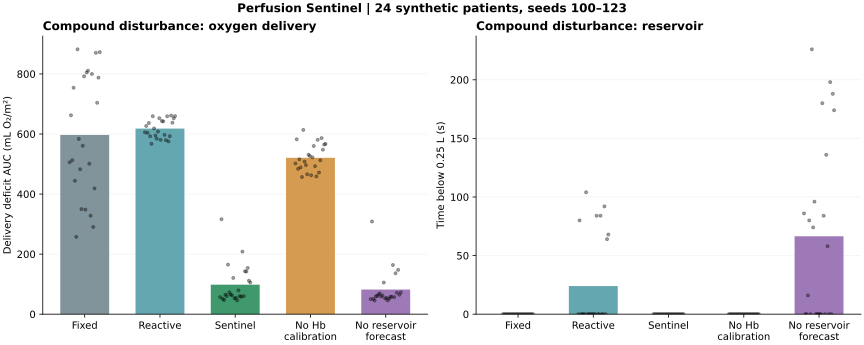
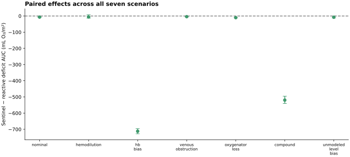
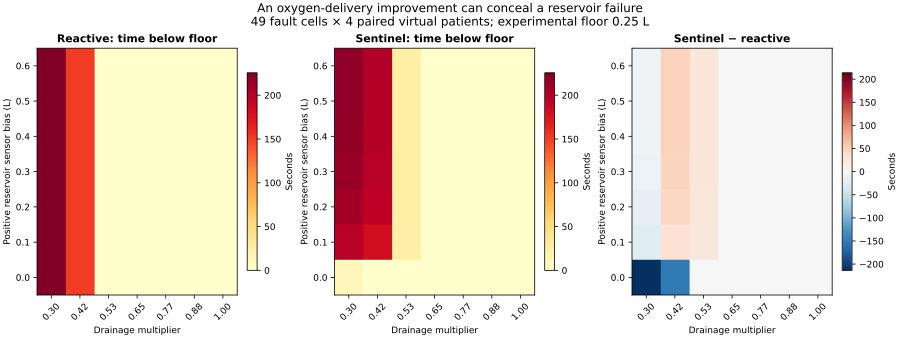

# Perfusion Sentinel

### A cardiopulmonary bypass simulation that asks when an oxygen monitor can be falsely reassuring.

**By Udeern Varanasi · Python / NumPy · Computational biomedical engineering**

[Interactive experiment replay](https://vudeern.github.io/perfusion-sentinel/) · [Portfolio](https://vudeern.github.io/projects.html) · [Research review](docs/RESEARCH.md) · [Model equations](docs/MODEL.md) · [Full results](docs/RESULTS.md)

A higher pump flow can improve oxygen delivery. It can also empty a venous reservoir when drainage is restricted. Meanwhile, a biased hemoglobin measurement can make the monitor report adequate delivery when the simulated patient is receiving less.

Perfusion Sentinel brings these interactions into one inspectable experiment: a coupled circulation model, injected sensing faults, an intermittent-reference observer, six competing control strategies, paired virtual-patient experiments, and a deliberate failure outside the observer's assumptions.

**This is an uncalibrated, synthetic research prototype. It does not control medical equipment, recommend treatment, predict organ injury, or reproduce a LivaNova product. There is no LivaNova affiliation or endorsement.**

## v1.4 research result: useful reference information; no demonstrated age-based advantage

An **8,568-run study** separates development selection from final evaluation with new seeds, magnitudes, timings and dynamics. With a good simulated level reference, simple timestamp-matched correction plus a **0.20 L margin** improves the sample means relative to the fixed **0.40 L reserve**: reservoir exposure **120.02 → 75.44 s**, empty requests **9.78 → 0.07 s**, and oxygen deficit **404.06 → 389.29 mL O₂/m²**. This additional contrast is descriptive and was added after final results; it is not the predeclared primary test.

**The age-based credibility method failed its primary joint criterion.** It lowers deficit further (342.11 versus 389.29), but has more reservoir exposure (79.65 versus 75.44 s) and empty requests (32.31 versus 0.07 s). It therefore does not demonstrate lower oxygen cost at comparable protection. Delayed, missing, biased and common-mode references remain explicit counterexamples to broad claims.

[Read the question, answer and paired intervals](docs/REFERENCE_RESULT.md) · [Primary verdict](results/reference-study/summary.json) · [Descriptive contrast](results/reference-study/secondary-contrast.json) · [All 8,568 outcomes](results/reference-study/metrics.csv)

## New in v1.3: the guard fails outside its original assumptions

A **4,320-run frozen-policy stress study** crosses nine sensing conditions with five plant regimes. On the reference plant, gradual drift and a startup level offset produce **88.83 s** and **100.25 s** mean reservoir exposure without level alarms. Every guarded run in one altered-drainage cell raises a level flag despite no injected sensor fault.

Across the equal-weight stress grid, the fixed reserve reduces exposure (7.13 versus 65.30 s) but increases oxygen deficit (285.65 versus 117.10 mL O₂/m²). These are different outcomes; neither method is a general solution. The new dynamics are declared engineering assumptions, not external physiological validation.

[Complete failure analysis and all 45 cells](docs/ROBUSTNESS.md) · [Frozen protocol](results/robustness/protocol.json) · [All 4,320 outcomes](results/robustness/metrics.csv)

## New in v1.2: challenge the guard against simpler protection

A 31-setting search compares the frozen guard with two simple modifications of original Sentinel: an always-on reserve margin and a fixed flow cap. Selection uses separate tuning seeds. A boundary-limited 2,240-run pilot is retained; the expanded final study uses 3,192 runs and untouched tuning, evaluation and stress-map seeds.

Across seven equally weighted synthetic scenarios and 24 evaluation patients, guarded mean oxygen deficit is **32.88** versus **88.82 mL O₂/m²** for the selected **+0.40 L reserve**, with zero measured reservoir depletion for both. **The reserve is better on the targeted sensor-bias scenario itself** (53.55 versus 101.43). The selected flow cap does not preserve its tuning depletion match on evaluation. These findings depend on the scenario mix and the current model.

[Full comparison, methods and negative results](docs/CONSERVATIVE_COMPARISON.md) · [Locked tuning selection](results/conservative-comparison/selection.json) · [All 3,192 final-study outcomes](results/conservative-comparison/metrics.csv)

## New in v1.1: investigate and mitigate the level-sensor failure

The new **Guarded Sentinel** policy detects reservoir-level discontinuities that violate a declared mass-balance envelope, corrects the inferred offset, and applies a reserve margin. Original Sentinel and its negative findings remain available.

In **24 fresh synthetic patients**, the +0.40 L sensor-bias scenario falls from **79.33 s to 0 s** mean time below the reservoir floor. **Oxygen-delivery deficit increases from 0.90 to 58.22 mL O₂/m².** The 49-cell stress map still contains failures at +0.10 L bias. This is a measured tradeoff, not a clinical safety claim.

[Full extension report and limitations](docs/LEVEL_GUARD.md) · [1,092 extension records](results/level-guard/metrics.csv) · [Recorded protocol](results/level-guard/protocol.json)

## Why this project exists

LivaNova's [investigator-initiated research priorities](https://www.livanova.com/en-us/contact-us/investigator-initiated-research) include predictive extracorporeal monitoring, perfusion workflow benchmarking, and modeling with advanced datasets. Its [Essenz platform](https://www.livanova.com/cardiopulmonary/en-us/essenz) already supports sensing, warnings, recorded data, and goal-directed perfusion. This project explores a related engineering question independently; the synthetic faults are **not observations about Essenz sensor behavior**.

The standard oxygen-delivery relationship is well established, as are automated reservoir/flow control and physiological oxygenation modeling. The contribution here is an open, reproducible **fault-testing benchmark** that combines:

- A clear separation between hidden plant truth, imperfect measurements, observer belief, and controller decisions.
- Intermittent independent Hb references to expose when a sensor bias becomes identifiable.
- Paired policy comparisons with common virtual patients and sensor-noise sequences.
- Calibration and reservoir-forecast ablations that expose the mechanisms behind a result.
- A failure map showing where an unmodeled level-sensor bias defeats the forecast.
- Reported failures, uncertainty coverage, pump demand and pressure excursions alongside oxygen-delivery scores.

This is a project-level engineering contribution, **not a claim of first-ever scientific novelty**. See the [prior-art comparison and evidence limits](docs/RESEARCH.md).

## See it before installing

Open the [live replay](https://vudeern.github.io/perfusion-sentinel/) or double-click `web/index.html` after downloading the repository. It works offline: no server, CDN, account, or patient data is required.

Choose a disturbance and strategy, scrub the timeline, and compare true delivery with the monitor. An additional calculator shows how hemoglobin and flow change arterial oxygen delivery under fixed hypothetical conditions.

The viewer replays exported **Python simulation output**. It does not execute a second physiology engine. Display samples are 6 seconds apart, with the final sample retained; summary metrics use every 2-second simulation interval. Seed 100 is selected by the protocol, not chosen after reviewing its appearance.

## Quick start

Requires Python 3.10+ and NumPy. Run these commands from the extracted repository directory:

```bash
python -m venv .venv
# macOS/Linux:
source .venv/bin/activate
# Windows PowerShell instead:
# .venv\Scripts\Activate.ps1

python -m pip install -e ".[plots]"
python -m unittest discover -s tests -v
perfusion-lab run --scenario compound --policy sentinel --seed 100 --out my-run
```

`my-run/run.json` contains patient parameters, scenario parameters, decisions, state estimates, truth and metrics. `my-run/run.csv` is a full-resolution trajectory suitable for plotting or independent analysis. The CLI prints the metrics.

For a minimal install without figure generation:

```bash
python -m pip install -e .
```

If the console command is unavailable, use `python -m perfusion_lab.cli` in its place.

## Reproduce the experiments

```bash
perfusion-lab benchmark --patients 24 --start-seed 100 --duration 1200 --dt 2 --target 280 --out results
python examples/build_web.py
python examples/make_figures.py
python examples/failure_map.py
python examples/plot_failure_map.py
python examples/validate_artifacts.py
python examples/level_guard_study.py
python examples/plot_level_guard.py
python examples/validate_level_guard.py
```

The main benchmark runs **24 patients × 7 scenarios × 6 strategies = 1,008 simulations**. Each experiment spans 20 simulated minutes at 2-second intervals. The failure map adds **392 runs**, and the new guard study adds **1,092 runs**, for **2,492 recorded simulations** in v1.1. The original v1.0 experiments contained 1,232 runs; those baseline results are preserved.

Runtime depends on the machine; there is no GPU requirement. The benchmark writes a large, regenerable `results/trajectories.json` for the replay exporter. It is intentionally excluded from source control and the release ZIP; the committed compact replay, every per-run metric, and the complete reproduction code are included.

The release's [environment record](results/environment.json) gives the versions used to produce the recorded outputs. Dependencies in `pyproject.toml` specify supported ranges; exact floating-point reproduction across all versions/platforms is not guaranteed. Seeds fix patient sampling, observation noise and bootstrap resampling within a compatible environment.

## What is simulated?

| Component | Implementation | Deliberate simplification |
|---|---|---|
| Circulatory storage | Conserved transfer between patient and reservoir | One effective patient storage compartment |
| Venous return | Filling pressure / venous resistance, modulated by obstruction | No cannula geometry, collapse or suction model |
| Pump | First-order command response and available-volume limiter | Flow-command abstraction, no RPM/head curve |
| Arterial pressure | Linear Windkessel with an exact held-input update | No pulsatility, detailed vasculature or CVP offset |
| Oxygen delivery | Hb-bound plus dissolved arterial oxygen content | PaO₂ fixed at 150 mmHg |
| Thermal demand | Scripted warming and a Q₁₀ demand proxy | No heat exchanger or coupled tissue thermodynamics |
| Hemodilution | Scripted reduction in Hb | No RBC-mass, priming or fluid-infusion model |
| Sensing | Independent Gaussian noise, Hb bias/dropout, intermittent reference | No device-specific calibration or error distributions |
| Observer | Last-reference Hb bias correction and widening stress bounds | Not a Kalman filter or individualized clinical twin |
| Predictive policy | 71 candidate commands and a 20-second local reservoir forecast | No nonlinear multistep optimizer or formal robustness proof |

The source is small enough to audit. Equations, units, parameter distributions and numerical choices are documented in [MODEL.md](docs/MODEL.md).

## Strategies and scenarios

| Strategy | Behavior |
|---|---|
| `fixed` | Holds a flow index of 2.4 L/min/m² |
| `reactive` | Adjusts flow from the current monitor's oxygen-delivery error |
| `sentinel` | Uses a lower Hb stress bound, pressure screening and reservoir forecasting |
| `sentinel_guarded` | Adds causal level-step detection, inferred offset correction and a latched reserve margin |
| `no_calibration` | Predictive policy without reference-based inline Hb bias correction |
| `no_lookahead` | Predictive policy without its reservoir forecast constraint |

All strategies share the same command range and slew-rate limits. Pressure and reservoir forecasting are intentional policy differences. The physical empty-reservoir limiter applies to every strategy, and failed requests are counted. The reactive comparator is a simple algorithm, not a reconstruction of clinical practice or a commercial system.

| Scenario | Injected disturbance |
|---|---|
| `nominal` | No sensing or drainage fault; scripted warming remains |
| `hemodilution` | Hb falls by 2.0 g/dL |
| `hb_bias` | Hb falls by 1.8 g/dL while inline Hb acquires a +2.0 g/dL bias |
| `venous_obstruction` | Drainage multiplier falls to 0.46 temporarily |
| `oxygenator_loss` | Arterial saturation falls by 0.16 |
| `compound` | Hb loss, positive bias, saturation loss, poor drainage and Hb dropout |
| `unmodeled_level_bias` | A +0.40 L level bias accompanies dilution and drainage restriction |

The timings are proportional to experiment duration; the independent Hb reference arrives every 180 seconds. Fault magnitudes are engineering stress assumptions, **not measured clinical rates**.

## What the original cohort results show



For the compound disturbance, the mean delivery-deficit area is **617.94 mL O₂/m² for reactive** and **98.25 for Sentinel**. The paired difference is −519.69, with a percentile bootstrap interval of [−540.41, −495.41] across these 24 synthetic patients. Mean time below the experimental reservoir floor is 24.0 seconds for reactive and 0 for Sentinel.

The ablations explain the tradeoff: without Hb calibration, mean compound deficit area is 520.79. Without the reservoir forecast, it is 82.03, but mean low-reservoir time rises to 66.5 seconds. Reducing an oxygen-deficit score alone can conceal a reservoir problem.

**A result against Sentinel:** under unmodeled level bias, its mean low-reservoir time is 149.92 seconds versus 139.58 for reactive; empty-reservoir requests total 40.08 versus 14.75 seconds. Its oxygen metric still improves. This is precisely why the benchmark reports several failure measures. The v1.1 guard extension investigates this failure on fresh seeds and reports both reduced depletion and worse oxygen deficit in [LEVEL_GUARD.md](docs/LEVEL_GUARD.md).

The engineering Hb bounds cover only about 83% of compound samples. They are not 95% confidence intervals. A clinical benefit or general safety claim cannot be inferred from these experiments.



Every scenario/policy result, the paired intervals and the negative findings are retained in [RESULTS.md](docs/RESULTS.md), [metrics.csv](results/metrics.csv) and [summary.json](results/summary.json).

## Failure envelope



The second experiment varies reservoir measurement bias from 0 to +0.60 L and drainage from 0.30 to 1.00. Four new virtual-patient seeds are paired between Sentinel and reactive at each of 49 points. The heatmap reports mean low-reservoir time for both policies and their difference. It is an exploratory stress map, not a safe operating envelope for a device.

## Metrics, with interpretation

- **Delivery-deficit AUC:** integral of `max(0, target − true DO₂i)` in mL O₂/m². This is a fixed-threshold exposure proxy, not physiological oxygen debt or AKI risk.
- **False reassurance:** true interval delivery is below target while the preceding monitor estimate is at/above target. It includes one-step sensing/actuation lag. Near-target noise can inflate its duration; `false_reassurance_margin_s` requires true delivery to be at least 5 units below target, and `concealed_deficit_auc` measures the deficit magnitude during these intervals.
- **Reservoir, pressure and empty requests:** time beyond experimental thresholds and time when requested transfer exceeds available volume. Physical limiting must not be mistaken for successful prevention.
- **Unmet-demand AUC:** a separate toy proxy using a hypothetical 60% extraction ceiling and temperature-dependent demand; it is not an organ injury model.
- **Hb-bound coverage, flow variation, mean flow and infeasibility:** describe estimation limitations, actuation burden and conflicting constraints.

See [DATA.md](docs/DATA.md) for every output field and the [validation record](docs/VALIDATION.md) for checks and practical limits.

## Extend the laboratory

The Python API accepts a named scenario or a custom `Scenario` and an optional patient:

```python
from perfusion_lab.model import Scenario, Patient
from perfusion_lab.simulation import simulate

fault = Scenario("custom", dilution=1.5, hb_bias=1.0,
                 drainage=0.6, reservoir_bias=0.15)
result = simulate(fault, policy="sentinel", seed=501,
                  patient=Patient(), lab_period=120.)
print(result["metrics"])
```

To add a policy, implement it in `control.py`, register it in `POLICIES`, and retain the common physical limits. To add a scenario, register a `Scenario` in `model.py`. Re-run all comparisons, not just a favorable seed. Keep policy tuning separate from reported evaluation and record any protocol changes.

## Repository guide

```text
src/perfusion_lab/   Plant, sensing, observer, controllers, simulation, benchmark, CLI
examples/           Replay export, figures, failure-map experiment, artifact checks
tests/              Physics, observer, controller, benchmark and web-contract checks
web/                Standalone offline replay and oxygen-delivery calculator
results/            Per-run metrics, protocols, bootstrap summaries, environment
docs/              Research review, model, data dictionary, results, validation
.github/workflows/  Python verification on 3.10 and 3.12
```

## What would make this research stronger?

The next steps are external calibration against approved clinical or bench datasets; independent noisy or redundant reservoir sensing; delayed references and common-mode sensor errors; a more realistic pump/cannula/oxygenator model; controller tuning with matched control effort; sensitivity to every assumed threshold; and evaluation of temporal mismatch and model-form error. The current virtual-patient distributions are uniform, independent engineering choices, not a representative patient population.

There is no basis here for clinical deployment. The project is useful as a transparent numerical experiment and a starting point for a carefully scoped research discussion.

## License and citation

MIT for the original code and synthetic outputs; third-party papers and trademarks retain their own rights. See [LICENSE](LICENSE), [CITATION.cff](CITATION.cff), and [CONTRIBUTING.md](CONTRIBUTING.md). The repository name preserves the spelling supplied for the project; the package and display name are **Perfusion Sentinel**.

