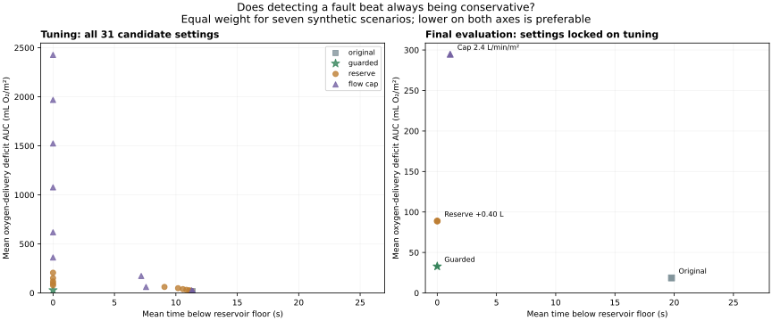
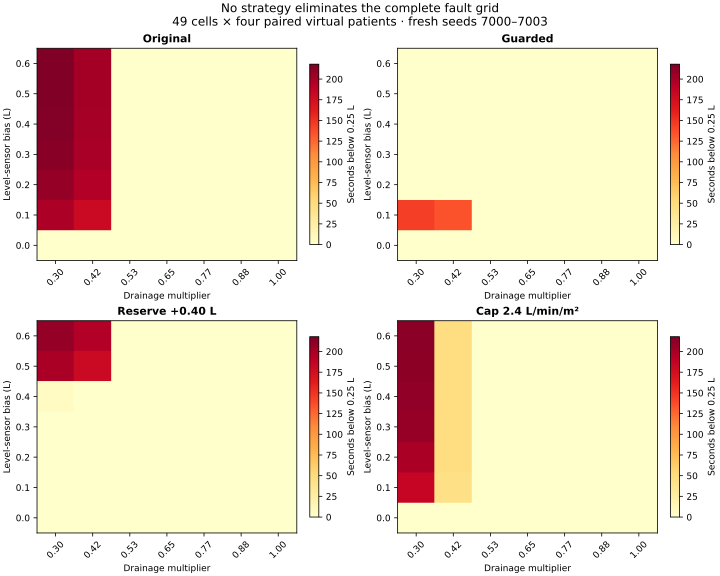

# Conservative comparator study — v1.2.0

## Question

Does the step-fault guard offer anything beyond keeping a larger reserve or limiting flow all the time? These comparators are simple modifications of original Sentinel, not reproductions of commercial devices or published state-of-the-art controllers. The guard, cost function, Hb observer, pressure screen, 20-second forecast and actuator limits are unchanged. No new guard parameters were tuned.

## Design history: retain the exploratory pilot

The first search used six reserve margins (0.10–0.60 L) and six cap indices (1.4–2.4 L/min/m²). Its cap selection hit the highest available setting. We expanded the search rather than report that boundary-limited comparison as decisive. The complete 2,240-run pilot remains in [conservative-pilot](../results/conservative-pilot/protocol.json), including all candidate metrics, selection and summaries. It is exploratory evidence and is not pooled into the final evaluation.

The expanded search uses **12 reserve margins** (0.05–0.60 L in 0.05 L steps) and **17 cap indices** (1.4–4.6 L/min/m² in 0.2 steps), plus original and guarded Sentinel: **31 candidate settings**. The upper cap is effectively inactive for all sampled patient sizes. The three final seed groups were unused in the pilot. The protocol is recorded internally, not independently preregistered.

## Selection before evaluation

- Tuning: seven scenarios × eight seeds (5000–5007) × 31 candidates = **1,736 runs**.
- Within each comparator family, select the lowest tuning mean oxygen deficit among candidates meeting both the guard’s mean low-reservoir and empty-request budgets. Ties follow the declared candidate order. If none meets both budgets, retain the least-exposure candidate and mark it unmatched.
- The resulting settings were written before evaluation: **+0.40 L reserve** and **2.4 L/min/m² flow cap**. Both met zero-exposure tuning budgets. Neither is a clinical recommendation.
- Final evaluation: seven scenarios × 24 fresh seeds (6000–6023) × four locked settings = **672 runs**.
- Final stress map: 49 fault cells × four fresh seeds (7000–7003) × four settings = **784 runs**.
- Final study total: **3,192 runs**, separate from the 2,240-run pilot. All run-level outcomes remain.
- Every run lasts 1,200 seconds at 2-second steps. Scenarios have equal artificial weight; this does not estimate clinical event frequencies. Bootstrap intervals resample the 24 patient seeds after averaging seven scenarios within each patient, rather than pretending there are 168 independent patients.



## Final pooled evaluation

Each row is an equal-weight mean over seven scenarios and 24 paired virtual patients. Deficit AUC is in mL O₂/m². Lower exposure and deficit are preferable, but these are different outcomes.

| Strategy | Low reservoir (s) | Empty requests (s) | Deficit AUC |
|---|---:|---:|---:|
| Original Sentinel | 19.77 | 0.31 | 18.57 |
| Guarded Sentinel | 0.00 | 0.00 | 32.88 |
| Reserve +0.40 L | 0.00 | 0.00 | 88.82 |
| Flow cap 2.4 L/min/m² | 1.10 | 0.00 | 294.79 |

Guarded Sentinel has **32.88** mean deficit versus **88.82** for the selected fixed reserve, with zero measured depletion/empty requests for both on this evaluation. The paired difference (reserve − guarded) is **55.93**, with a 95% percentile bootstrap interval **[51.03, 60.81] mL O₂/m²**. A degenerate zero-exposure interval is only an observation of this finite sample, not proof of zero risk.

**The cap does not preserve its tuning risk match on evaluation:** its mean low-reservoir exposure is 1.10 s versus zero for guarded. Do not describe this as an exactly risk-matched evaluation comparison.

## Scenario-level outcomes: the important reversal

The next table reports mean deficit AUC in mL O₂/m²; all other metrics are retained in the CSV and JSON.

| Scenario | Original | Guarded | Reserve +0.40 L | Cap 2.4 |
|---|---:|---:|---:|---:|
| nominal | 0.22 | 0.22 | 0.22 | 0.23 |
| hemodilution | 4.74 | 4.74 | 4.74 | 456.31 |
| hb_bias | 51.26 | 51.26 | 51.26 | 387.04 |
| venous_obstruction | 0.84 | 0.84 | 202.16 | 0.85 |
| oxygenator_loss | 0.31 | 0.31 | 0.31 | 271.92 |
| compound | 71.37 | 71.37 | 309.47 | 571.93 |
| unmodeled_level_bias | 1.27 | 101.43 | 53.55 | 375.26 |

**The simpler reserve wins on the +0.40 L sensor-fault scenario:** its deficit is **53.55**, compared with **101.43** for guarded, with zero depletion for both. The guard’s pooled advantage comes from avoiding unnecessary conservatism in other scenarios, especially venous obstruction and compound faults. The conclusion depends on how scenarios are weighted; it is not universal superiority.

In that same scenario, guarded averages 0.08 s above the pressure ceiling versus 0.00 s for the reserve. The guard therefore does not dominate every secondary measure either.

## Full stress map



The settings remain locked on the stress map; no cell-specific retuning is performed. All four strategies retain failures. Cell counts below concern low-reservoir time only; equal cells include both successes and unresolved failures.

| Strategy | Cells better / equal / worse than guarded | Worst cell mean exposure (s) |
|---|---|---:|
| Original Sentinel | 0 / 37 / 12 | 218.00 |
| Guarded Sentinel | 0 / 49 / 0 | 144.00 |
| Reserve +0.40 L | 2 / 42 / 5 | 208.00 |
| Flow cap 2.4 L/min/m² | 1 / 37 / 11 | 212.50 |

## Bounded conclusion and next falsification

Under this equal-weight synthetic challenge set, the guard reduces the oxygen cost of protection relative to the selected always-on reserve. A fixed reserve is better in the targeted bias scenario itself. The cap’s protection does not generalize completely to fresh seeds. These are comparative numerical findings, not established scientific novelty, clinical usefulness or evidence of a market.

The same structural plant and scripted fault timing are used in tuning and evaluation. New seeds are not new physiology or external measurements. The finite grids do not exhaust simple policies, especially conditional threshold/rate alarms, joint reserve/cap tuning, or optimized adaptive margins. The next study should challenge those comparators, scenario weights, gradual drift, initial offsets, flow-sensor faults and plant mismatch. External bench/data validation remains necessary before claims about real equipment.

## Reproduce

```bash
python -m pip install -e ".[plots]"
python -m unittest discover -s tests -v
python examples/conservative_study.py --pilot  # optional: reproduce archived exploratory pilot
python examples/conservative_study.py
python examples/plot_conservative_study.py
python examples/report_conservative_study.py
python examples/validate_conservative_study.py
node tests/web_contract.cjs
```

The replay’s “Conservative comparison” dataset uses evaluation seed 6000 and locked settings. Its cohort differences use guarded Sentinel as the reference; the original dataset continues to use reactive.

[Protocol](../results/conservative-comparison/protocol.json) · [Frozen tuning selection](../results/conservative-comparison/selection.json) · [All final-study metrics](../results/conservative-comparison/metrics.csv) · [Complete means and intervals](../results/conservative-comparison/summary.json) · [Execution environment](../results/conservative-comparison/environment.json)
