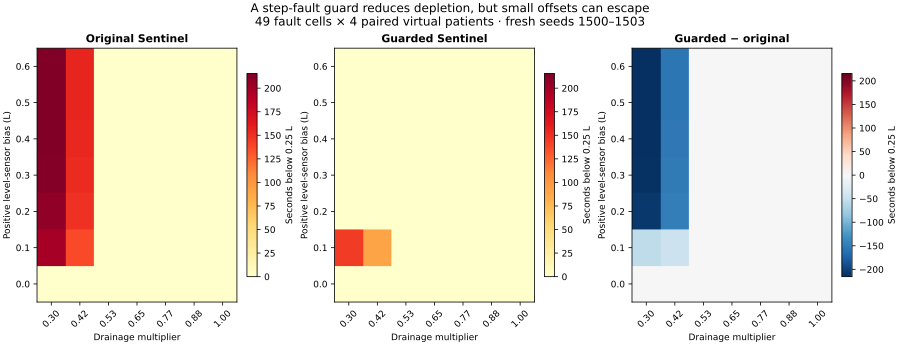

# Reservoir step-fault guard — v1.1.0

This extension follows the original benchmark’s documented level-sensor failure. It adds `sentinel_guarded` while preserving the original Sentinel policy and all five original strategies. Every field of the original 840 main-benchmark records was reproduced exactly before adding 168 guarded runs.

## Hypothesis and implementation

A positive sensor jump can inflate both the apparent reservoir volume and the drainage estimate used by the forecast. The new observer compares each level increment with a causal mass-balance envelope: drainage is assumed to lie between 0 and 7.5 L/min, and flow is independently measured. The envelope has a 0.03 L noise/model allowance. An increment outside it is treated as a level-sensor discontinuity. Its size is estimated from the previous drainage estimate and the current flow; the inferred offset is removed before updating drainage and forecasting reservoir volume. After any detection, an extra 0.08 L reserve allowance remains latched for the rest of the run. The original command limits, pressure screen, Hb observer, cost function and 20-second horizon are unchanged.

The observer receives only current and past observations. It never receives the true reservoir, scenario name, true bias magnitude or future fault timing. The drainage cap is an explicit model assumption, not independent physiological validation. The 0.08 L allowance is an engineering choice, not a confidence bound.

## Evaluation protocol

The detector constants and evaluation script were fixed before running the extension study; no tuning was performed on its results. This is an internally recorded protocol, not an external preregistration.

- Fresh cohort: seven existing scenarios × 24 seeds (1000–1023) × three policies = **504 runs**.
- Fresh stress map: seven biases (0–0.60 L) × seven drainage multipliers (0.30–1.00) × four seeds (1500–1503) × three policies = **588 runs**.
- All 1,092 extension runs last 1,200 seconds at 2-second steps; paired policies share virtual patients and observation noise.
- Primary outcome: time below the experimental 0.25 L reservoir floor. Oxygen deficit, empty requests, pressure, pump burden and alarm duration are retained.
- The main replay benchmark also now includes all six policies: **1,008 runs** on seeds 100–123. The original **392-run** failure map remains unchanged. Total retained records: **2,492**.
- Paired percentile bootstrap intervals use 2,000 resamples and seed 2026. They describe this synthetic sampler, not a clinical population.

## Fresh cohort results

Each entry is a mean across the same 24 synthetic patients. Deficit AUC is in mL O₂/m²; reservoir exposure is in seconds.

| Scenario | Original low-reservoir s | Guarded low-reservoir s | Original deficit AUC | Guarded deficit AUC |
|---|---:|---:|---:|---:|
| nominal | 0.00 | 0.00 | 0.35 | 0.35 |
| hemodilution | 0.00 | 0.00 | 8.57 | 8.57 |
| hb_bias | 0.00 | 0.00 | 47.04 | 47.04 |
| venous_obstruction | 0.00 | 0.00 | 0.82 | 0.82 |
| oxygenator_loss | 0.00 | 0.00 | 0.46 | 0.46 |
| compound | 0.00 | 0.00 | 77.58 | 77.58 |
| unmodeled_level_bias | 79.33 | 0.00 | 0.90 | 58.22 |

For the +0.40 L level-bias scenario, mean reservoir exposure falls from **79.33 s to 0 s**. The paired difference is **−79.33 s**, with a 95% bootstrap interval of **[−115.75, −43.92] s**. Reactive has 50.58 s of exposure. Empty-reservoir requests are zero for all three policies in this fresh scenario cohort.

**The cost is worse oxygen delivery:** guarded deficit AUC rises from **0.90 to 58.22 mL O₂/m²** (difference **+57.32**, interval **[31.72, 85.43]**). Reactive has 11.99 mL O₂/m². This is a depletion/oxygen-delivery tradeoff, not global superiority. In the six other existing scenarios, guarded and original cohort mean outcomes are identical and no level alarms occur.

## Stress map and remaining failures



Compared with original Sentinel, mean low-reservoir time improves in **12 of 49 cells**, is equal in **37**, and is worse in **0** on this grid. Equality includes both zero-exposure cells and unresolved failures; it must not be interpreted as universal success.

At **+0.10 L** bias the guarded policy still reaches **144.5 s** mean exposure in the worst cell. Some small jumps stay within the physical envelope; detecting a later jump when the bias disappears cannot undo earlier exposure. The observer cannot identify a constant initial offset or slow drift without additional information. Outliers or inaccurate flow sensing can be misclassified as level faults. Unmodeled drainage, longer sampling intervals, and plant mismatch can invalidate the envelope. No independent noisy flow-fault study, drift study, clinical dataset or bench validation has been completed.

## Reproduce and inspect

```bash
python -m pip install -e ".[plots]"
python -m unittest discover -s tests -v
python examples/level_guard_study.py
python examples/plot_level_guard.py
python examples/validate_level_guard.py
perfusion-lab benchmark --out results
python examples/build_web.py
node tests/web_contract.cjs
python examples/validate_artifacts.py
```

[Protocol](../results/level-guard/protocol.json) · [All per-run metrics](../results/level-guard/metrics.csv) · [Means, intervals and map](../results/level-guard/summary.json) · [Execution environment](../results/level-guard/environment.json)

The replay uses seed 100 and aggregate seeds 100–123; the table above uses fresh seeds 1000–1023. They are separate cohorts and their means should not be interchanged. This synthetic research prototype has no clinical calibration or demonstrated patient benefit.
