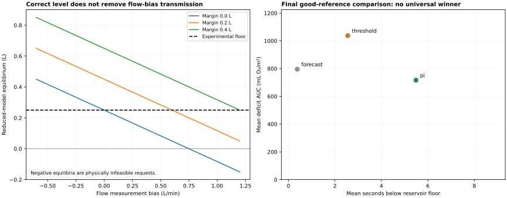
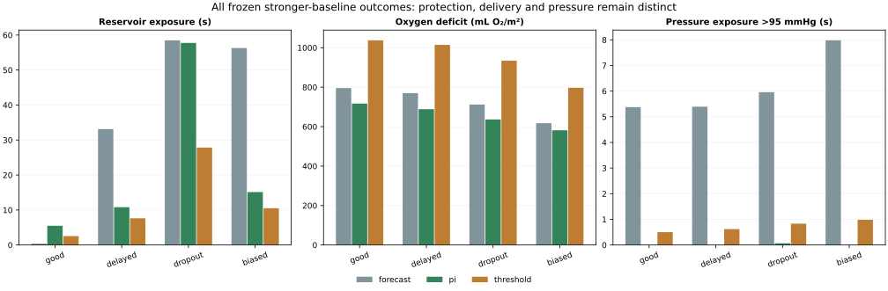

# Flow-measurement bias in reservoir forecasts: an analytic mechanism and reproducible reference-assisted control benchmark

**Working manuscript for independent review. Not submitted or peer reviewed.** Prepared for Udeern Varanasi. Author details, funding/competing-interest declarations and final author approval remain to be completed. Scientific priority and suitability for a particular venue have not been established.

## Abstract

**Objective.** Determine how additive flow-measurement bias can defeat a reservoir forecast despite level-reference correction, and assess whether stronger flow-independent feedback baselines improve the protection–oxygen-delivery tradeoff in an open simulation benchmark.

**Methods.** We derive a reduced active-constraint equilibrium and an indistinguishable-system construction, verify the equilibrium independently in 160 scalar cases, and add level PI and threshold baselines that ignore measured flow. All controllers receive the same timestamped level-reference information. Twenty-two candidate configurations are compared on 2,464 development runs, with one per family frozen before 4,032 final runs with new seeds, fault magnitudes, timing and dynamics. The primary comparison uses 16 paired virtual patients with good references; patient-block bootstrap intervals preserve within-patient correlation. Published aggregate operating ranges support a limited plausibility audit, not external time-series validation.

**Results.** In the reduced model, equilibrium volume is V* = V_min + m − c − Hb/60, where m is reserve margin, c residual level offset, H forecast horizon and b flow bias. Correcting c does not remove b. Independent scalar errors are below 8.7e-15 L. The PI and threshold baselines have exact physical-output invariance to sensor-only flow-bias changes in this implementation. In the final good-reference group, PI deficit AUC was 716.95 versus 795.36 mL O₂/m² for forecast, but low-reservoir exposure was 5.49 versus 0.38 s. The primary joint criterion was not met.

**Conclusion.** A level reference alone does not repair a flow-biased drainage forecast. Stronger simple baselines change the comparison, but no universal controller benefit or clinical safety follows. The contribution offered for review is a transparent mechanism-and-benchmark analysis; the PI/threshold algorithms and algebra are not claimed as new control theory. Physical validation and independent assessment of the application-level literature gap remain necessary for broader claims.

## 1. Introduction

Reservoir depletion and adequate oxygen delivery impose competing demands on pump control. Automatic reservoir/flow regulation has already been demonstrated experimentally [1], and predictive level warnings are established [2]. Independent reservoir measurement also predates this project [3]. Consequently, neither automatic control, an additional level reference, nor PI control is an original contribution by itself. Related industrial tank work also addresses sensor fault tolerance [5].

This study focuses on a narrower failure route: an inflow estimate formed by adding measured outflow to a reservoir derivative inherits additive flow bias. Improving the level measurement can therefore leave a dangerous forecast error intact. We connect that mechanism to a reproducible numerical benchmark and stronger simple comparators. The candidate application-level contribution is the auditable combination of explicit information assumptions, counterexamples and equal-information tests; its novelty remains provisional pending a broader review.

The study asks two questions. First, what can level and flow channels identify without an independent inflow or trusted actuator anchor? Second, does a level PI baseline lower oxygen deficit relative to a tuned forecast while maintaining comparable reservoir and pressure exposure? Failed comparisons and adverse cases are retained.

## 2. Reduced-model analysis

Let V be volume in L, q_v and q_a inflow/outflow in L/min, and y_q = q_a + b the measured flow. Conservation is V̇ = (q_v − q_a)/60. With unmeasured unconstrained inflow and no trusted calibrated actuator model, replacing (q_v, q_a, b) with (q_v + δ, q_a + δ, b − δ) preserves both y_q and V̇. Accurate volume measurement alone does not distinguish the systems. This information statement does not apply when a trusted additional channel removes the ambiguity.

For a noiseless time-aligned derivative estimate, q̂_v = y_q + 60V̇ = q_v + b. If the level retains offset c and the controller subtracts margin m, its H-second forecast is V + c − m + (q̂_v − u)H/60. With that floor constraint active, ideal instantaneous actuation and other limits inactive, solving for command u and substituting into conservation gives

$$\dot V=-\frac{V-[V_{\min}+m-c-Hb/60]}{H},\qquad
V^*=V_{\min}+m-c-Hb/60.$$

Thus equilibrium floor protection requires m ≥ c + Hb/60 under these assumptions. At H = 20 s, m = 0.20 L, c = 0 and b = 0.90 L/min, V* = 0.15 L, below the experimental 0.25 L floor. A forward-Euler update is stable for 0 < Δt/H < 2. The full proof, assumptions and numerical checks are in [THEORY.md](THEORY.md).

The full plant contains actuator lag, filtering, clipping, other constraints, noise and time-varying faults. Its exact trajectories are not asserted to follow the reduced equilibrium. Negative mathematical equilibria identify requests outside the physical domain; the simulator never permits negative reservoir volume.

## 3. Simulation and comparison methods

### 3.1 Plant and information

The existing plant conserves transfer between a venous reservoir and one compliant patient-storage compartment, with an arterial Windkessel and a first-order pump command response. Oxygen content links Hb, saturation and flow to indexed delivery. Parameter values and disturbance magnitudes are engineering choices, not fitted clinical distributions. The 280 mL/min/m² delivery target and 0.25 L floor are experimental comparators, not patient-specific recommendations. The model does not predict organ injury.

Every method receives the same measurement channels, Hb-reference process, independent level-reference schedule and paired random noise/dropout. Delivered level references are matched to stored inline readings at acquisition time. The common reference correction holds the resulting level-bias estimate; it supplies no true flow or drainage. The final reference regimes are good, delayed, dropout and biased. The good channel has a 60-second period, 4-second delay and independent noise SD 0.01 L; its hardware feasibility is not established by this simulation.

### 3.2 Controllers

The forecast controller retains the original finite-candidate oxygen/flow cost and a 20-second drainage forecast. It estimates effective arterial resistance using measured pressure divided by measured flow. Candidate reserve margins range from 0 to 0.50 L.

The PI baseline caps oxygen-demand flow by level PI feedback, with tracking anti-windup. The threshold baseline slows toward zero below a level threshold and otherwise follows oxygen-demand flow. Both ignore measured flow and inferred drainage. They use direct pressure slowdown at 90 mmHg; forecast instead screens predicted pressure against 95 mmHg. This is a documented design difference, not an exact reconstruction of a published hardware controller. All share the 0–7 L/min command range, 0.15 L/min/s slew limit and measurement channels; all are scored for actual pressure above 95 mmHg.

Because flow bias changes only a sensor channel that PI/threshold do not consume, their physical trajectories remain identical under a sensor-only bias perturbation, by induction on equal controller/plant states and paired random draws. This does not prove good performance or protection against level/reference faults. Monitor-derived scores can still change. The property is tested in unit-level trajectories and 384 final paired counterfactuals.

### 3.3 Development, freezing and evaluation

Development includes seven sensing cases, two plants, eight seeds (11000–11007) and 22 configurations: six forecast margins, twelve PI gain/target combinations and four thresholds. Within each family, the lowest deficit candidate meeting mean low-reservoir and empty-request budgets of 1 second is selected. If none qualifies, the least-exposure candidate is retained and labelled unmatched. These budgets are engineering selection rules. Selection is saved and hashed before evaluation. Candidate grids are finite; the selected forecast margin and PI target lie at grid boundaries, so no global optimality is asserted.

Final evaluation uses seeds 12000–12015, seven sensing conditions, three plant settings, four reference regimes and three frozen methods: 4,032 runs. Total new runs are 6,496. Final level offsets are 0.60 L, positive flow bias 1.10 L/min, noise scaling 14×, restriction fraction 0.35, and altered event timing. Pump/lag/nonlinearity settings also differ from development. These are held-out parameter conditions within known fault families, not an independent physiological dataset.

The primary good-reference comparison requires PI-minus-forecast upper 95% paired intervals ≤1 s for reservoir/empty-request exposure and ≤5 s for high-pressure exposure, with a deficit-AUC upper interval below zero. Tolerances are not clinical noninferiority margins. Other comparisons are descriptive. The plan was internally recorded before evaluation, not independently preregistered.

### 3.4 Statistics and verification

Scenarios have equal artificial weights. Metrics are first averaged across cells within each patient seed; 2,000 paired percentile bootstrap resamples of 16 patient blocks use random seed 2026. Correlated cells are not treated as independent patients. Raw runs, protocols, selections and scripts are retained, including earlier exploratory studies that are not pooled into this evaluation. The analysis verifies all 60 grouped paired intervals and independently reruns all 12 prespecified final replay trajectories.

## 4. Results

### 4.1 Primary good-reference outcomes

| Method | Low reservoir (s) | Empty requests (s) | Deficit AUC (mL O₂/m²) | Pressure exposure (s) |
|---|---:|---:|---:|---:|
| Forecast +0.5 L | 0.38 | 0.00 | 795.36 | 5.38 |
| Level PI · target 0.6 L | 5.49 | 0.14 | 716.95 | 0.00 |
| Threshold slowdown · 0.8 L | 2.55 | 0.27 | 1037.65 | 0.50 |

PI-minus-forecast differences, with 95% paired intervals, were 5.11 [2.60, 7.85] s for reservoir exposure, 0.14 [0.00, 0.35] s for empty requests, -78.41 [-90.33, -66.99] mL O₂/m² for deficit, and -5.38 [-16.12, 0.00] s for pressure exposure. The primary joint result is **not_demonstrated**. Lower deficit does not compensate for a failed protection criterion under the declared test.

### 4.2 Reference reliability

| Reference | Forecast low / deficit | PI low / deficit | Threshold low / deficit |
|---|---|---|---|
| good | 0.38 / 795.36 | 5.49 / 716.95 | 2.55 / 1037.65 |
| delayed | 33.14 / 769.75 | 10.81 / 688.48 | 7.64 / 1014.21 |
| dropout | 58.50 / 711.87 | 57.76 / 636.44 | 27.84 / 934.14 |
| biased | 56.30 / 617.39 | 15.12 / 581.35 | 10.51 / 796.73 |

Units are seconds / mL O₂/m². All 84 final cells remain in the machine-readable summary. Delayed, missing or biased references change the tradeoff; no method is labelled universally superior.

### 4.3 Verification and published-range audit

All 160 independent scalar calculations match the closed-form equilibrium within 1e-9 L. The flow-independent baselines retain identical true outcomes in all 384 final sensor-only counterfactual pairs. These are mathematical/software checks, not external experimental validation.

An audit of 200 nominal fixed-flow model draws found a pressure range of 42.74–88.50 mmHg; 74% fell between survey-derived mean operating limits reported in [4]. This is not an accuracy or safety rate. No raw reservoir bench time series was used to calibrate or validate the plant. The range comparison neither establishes dynamic fidelity nor justifies crisis-management claims.

## 5. Discussion

The reduced mechanism explains why improving level information can leave flow-dependent forecasting errors intact. It also motivates a necessary comparison: a controller that does not consume the unreliable flow channel. PI and threshold control are established methods; their role here is to challenge the benchmark rather than provide a new algorithm. The stronger comparison changes the oxygen/protection balance but does not satisfy the declared joint PI criterion in this study.

The invariance result is intentionally limited. Ignoring a channel eliminates direct dependence on its bias, but supplies no guarantee against bad level references, different actuator dynamics or inadequate inflow. Likewise, a small scalar numerical error is verification of an ideal calculation, not validation of the underlying physiology. Negative or null method comparisons can still be informative when conditions, failures and scope are explicit.

The main remaining uncertainties are the uncalibrated plant, artificial fault magnitudes and scenario weights, finite candidate grids, simple pressure handling, modest number of paired virtual patients and incomplete external evidence. The scoped literature audit does not prove scientific priority. A broader review may find equivalent mechanism analyses or benchmarks. Physical validation and expert review are required before representing the work as practically relevant to equipment or patients.

## 6. Conclusion

In the stated reduced model, residual level error and flow bias transmit additively into forecast-floor error through c + Hb/60. Independent level correction alone does not remove the flow term. Flow-independent simple baselines provide a stronger comparison class, yet the tested PI method does not demonstrate the declared joint protection/oxygen advantage. The work supplies a reproducible, mechanism-grounded failure benchmark for review, without claiming a validated medical controller, first-in-field method or guaranteed publication.

## Data, code and reproducibility

- [Recorded protocol](../results/submission-study/protocol.json), [frozen selection](../results/submission-study/selection.json), [all new runs](../results/submission-study/metrics.csv), [all cells and paired intervals](../results/submission-study/summary.json).
- [Scalar/range audit](../results/mechanism-audit/summary.json), [full derivation](THEORY.md), [literature/evidence audit](LITERATURE_AUDIT.md).
- Run `python examples/mechanism_audit.py`, `python examples/submission_study.py`, `python examples/plot_submission_study.py`, `python examples/validate_submission_study.py` and the repository tests. Use `python examples/write_manuscript.py` to regenerate this draft after outputs exist.

## Ethics, assistance and author declarations

No patient records, human/animal experiments or medical-equipment control were used. No ethics-waiver determination is claimed. ChatGPT/Codex assisted software, study-script and manuscript drafting; an independently recorded exact model version is unavailable. The human author must verify the equations, implementation, analysis, citations and declarations before submission. Funding, competing interests and final author/affiliation details remain for author confirmation. No external domain review or author submission approval has been recorded.

## References

1. Takahashi H, et al. Simultaneous Control of Venous Reservoir Level and Arterial Flow Rate in Cardiopulmonary Bypass With a Centrifugal Pump. IEEE J Transl Eng Health Med. 2023;11:435–440. [doi:10.1109/JTEHM.2023.3290951](https://doi.org/10.1109/JTEHM.2023.3290951).
2. Shinohara T, et al. Predictive monitoring of venous reservoir level fluctuations and rapid depletion during CPB via real-time image analysis. Perfusion. 2026. [doi:10.1177/02676591261489051](https://doi.org/10.1177/02676591261489051).
3. Montano SR, Morris RW, Pybus DA. The use of a load cell for continuous cardiotomy reservoir level measurement during cardiopulmonary bypass. Perfusion. 1996;11:319–325. [doi:10.1177/026765919601100404](https://doi.org/10.1177/026765919601100404).
4. Searles BE, Darling EM, Riley JB. Objective Content Validation of the Hemodynamic and Technical Parameters of the Orpheus Cardiopulmonary Bypass Simulator. J Extra Corpor Technol. 2021;53:263–269. [doi:10.1182/ject-53-263](https://doi.org/10.1182/ject-53-263).
5. Irfan M, et al. Design of a fault-tolerant control system for a centrifugal pump-based level control system for sensor faults. Scientific Reports. 2026;16:14189. [doi:10.1038/s41598-026-42361-x](https://doi.org/10.1038/s41598-026-42361-x).
