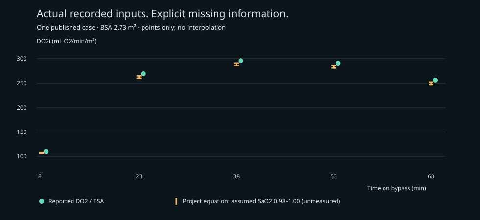

# Published-patient oxygen replay

## What was actually done

One actual published CPB case is now replayed at its five reported observation times, using recorded flow, Hb and PaO2 and the reported BSA. This is an **oxygen-equation replay**, not a fitted digital twin or a simulation of that patient's reservoir response. No raw monitor export was obtained. No invented points fill the 15-minute gaps; no continuous deficit AUC is calculated.

Source: Hunter KT II, Lopez AR, Yun KL. *Emergent Cardiopulmonary Bypass for a 180 Kilogram Patient: Support with a Single Oxygenator.* J Extra Corpor Technol. 2013;45:178–182. [Table 1 and case description](https://pmc.ncbi.nlm.nih.gov/articles/PMC4557537/). Numerical facts were manually transcribed and checked; original article copyright remains with AMSECT. See [provenance](../data/published-case/provenance.json) and [input CSV](../data/published-case/observations.csv).

## Measurements and assumptions

The case reports BSA **2.73 m²**. Table 1 supplies timed pump flow, Hb, PaO2, temperature and calculated oxygen delivery. **Arterial saturation is absent.** Mixed venous saturation must not be substituted for arterial saturation. We show chosen SaO2 sensitivity endpoints **0.98–1.00**, not measured values, confidence intervals or guaranteed physiologic bounds. Temperature is retained as context; the content equation is not temperature adjusted.

The project equation is `DO2i = 10 × flow × (1.34 × Hb × SaO2 + 0.0031 × PaO2) / BSA`. Existing synthetic experiments retain their original 150 mmHg PaO2 default. The new optional PaO2 input and replay use the reported values.

| Time (min) | Flow (L/min) | Hb (g/dL) | PaO2 (mmHg) | Reported DO2 / BSA | Project DO2i, SaO2 sensitivity |
| --- | --- | --- | --- | --- | --- |
| 8 | 2.61 | 7.27 | 521 | 110.48 | 106.71–108.58 |
| 23 | 4.70 | 10.67 | 350 | 269.11 | 259.91–264.83 |
| 38 | 4.70 | 11.67 | 408 | 295.79 | 285.61–291.00 |
| 53 | 5.25 | 10.33 | 335 | 290.74 | 280.84–286.17 |
| 68 | 5.04 | 9.33 | 369 | 256.04 | 247.31–251.93 |

Oxygen delivery units: mL O2/min/m². The five observations are samples of one patient, not five independent patients.



## Result and interpretation

At the same assumed saturation, replacing the old fixed PaO2 of 150 with the reported PaO2 raises calculated DO2i by **10.67–13.77 mL O2/min/m²** across these samples. This quantifies a simplification in our oxygen module on actual recorded inputs; it does not establish a new physiological finding.

The source's Figure 2 uses coefficients **1.36 and 0.0032**, whereas this project's unchanged equation uses **1.34 and 0.0031**. With source coefficients and an explicit saturation=1 assumption, the largest absolute difference from reported total DO2 is **0.200 mL/min**. We did not tune coefficients or saturation to the reported output. Rounded inputs and unreported saturation limit interpretation. Agreement between two calculated quantities checks arithmetic consistency, not predictive accuracy or clinical validation.

## What prevents the requested dynamic patient simulation

Synchronized pump commands, reservoir volume, venous return, time-resolved volume transfers and arterial pressure are missing. The five sparse samples cannot identify the patient's drainage, storage, actuator or sensor-bias dynamics. Running the existing synthetic reservoir using this patient's BSA would add assumed physiology; we do not label that a validated patient twin. The existing manuscript's reservoir conclusions remain synthetic.

A suitable next dataset must contain recorded inputs and independently observed responses at adequate resolution. Fit only on a development interval/cases, compare one-step and multi-step held-out predictions with persistence and simple physical baselines, and evaluate calibration across other patients before interpreting controller counterfactuals. Actual recorded care cannot establish outcomes under an unobserved alternative controller.

## Data-source audit

- **Selected:** the public Hunter case supplies five timed oxygen-input observations, usable now within the scope above.
- **[Mendeley CPB blood gases](https://data.mendeley.com/datasets/zkyr3hnmkr/4):** public metadata describes blood gases, not the required reservoir-control channels; no raw file was ingested. Direct metadata retrieval from this runtime returned HTTP 403.
- **[INSPIRE 1.4.2](https://physionet.org/content/inspire/1.4.2/):** credentialed access requires approved user status, CITI training and a signed DUA. No credentialed records were downloaded; synchronized pump/level channels remain unverified. Access alone is not evidence of suitability.
- **[GARIX](https://journals.sagepub.com/doi/10.1177/02676591251375788):** published minute-level pediatric CPB modeling supports feasibility; raw patient access was not established in this search.
- **[CM-CAD v1.2](https://zenodo.org/records/22144463):** release README describes ECG/SCG/PCG and session-level references. It does not establish synchronized CPB reservoir and command traces; CABG recordings alone do not meet our requirement.

This scoped search did not locate an openly retrievable, verified reservoir/command patient series. It does not prove none exists. No authors were contacted and no access agreements were accepted on the user's behalf.

## Reproduce

```bash
python examples/published_patient_replay.py
python examples/published_patient_replay.py --check
```

Outputs: [JSON with explicit evidence status](../results/published-case/replay.json), [derived CSV](../results/published-case/replay.csv), this report and the figure. The check recomputes all artifacts from source inputs and checks exact equality. Unit tests separately cover explicit units, missing saturation, input rejection, and oxygen-equation arithmetic.
