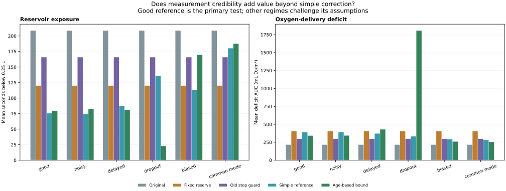
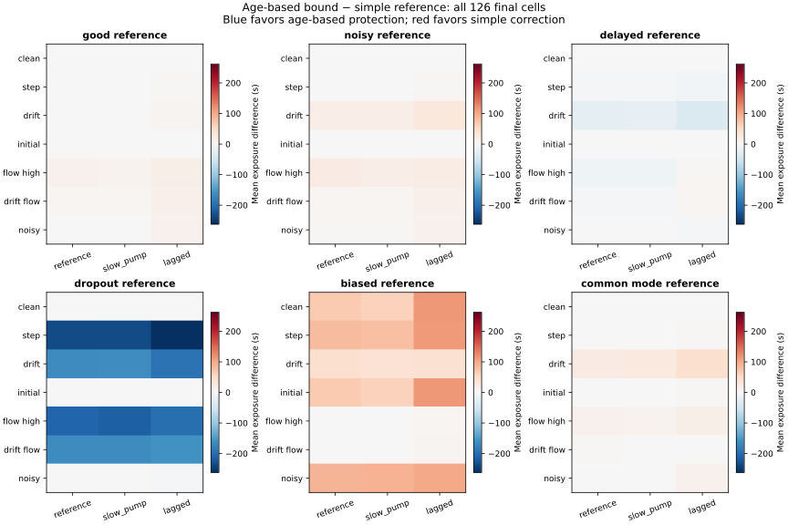

# Independent level reference: the research answer — v1.4.0

## Question and answer

**Question:** Does an age-based measurement-credibility allowance outperform a tuned simple reference correction, given the same noisy, delayed measurements?

**Answer: No advantage was demonstrated on the declared primary synthetic test.**

This addresses the method comparison inside the simulator. It does not answer whether the software is effective on actual equipment, scientifically novel, publishable at a particular venue, patentable or commercially valuable. Those questions remain open.

## The broader engineering question

Under the good simulated reference channel, the simple-reference package has lower mean reservoir exposure (**75.44 versus 120.02 s**), empty requests (**0.07 versus 9.78 s**) and oxygen deficit (**389.29 versus 404.06 mL O₂/m²**) than always keeping the original +0.40 L reserve. Thus there is evidence of a useful tradeoff improvement for this reference-plus-correction package inside the simulator. Added information has a cost and must actually be obtainable; neither hardware cost nor real reference performance is established here.

This simple-reference versus fixed-reserve contrast was added descriptively after seeing the final results. It does not replace the failed/passed primary test above, and is not presented as an independently predeclared confirmation. The intervals below use the same paired patient blocks.

| Outcome | Simple reference − fixed reserve | 95% paired interval |
|---|---:|---|
| low_reservoir_s | -44.58 | [-51.83, -37.29] |
| empty_request_s | -9.71 | [-13.02, -6.71] |
| deficit_auc | -14.78 | [-25.31, -5.75] |

The result supports a narrow distinction: the reference-plus-simple-correction package improves these three sample means relative to the fixed reserve with a good reference; extra age-based complexity must still earn its own benefit. It does not isolate an information effect from every policy change, and it does not generalize that gain to faulty reference channels.

## Primary test: good reference channel

The primary reference is sampled every 60 seconds, delivered after 4 seconds, with independent Gaussian noise SD 0.01 L. Results below average seven final sensing conditions and three plant settings equally within each of 12 paired virtual patients (seeds 10000–10011). The cells are not treated as independent patients, and their weights are not clinical frequencies.

| Method | Low reservoir (s) | Empty requests (s) | Deficit AUC (mL O₂/m²) |
|---|---:|---:|---:|
| Original · ignores level reference | 208.58 | 98.60 | 216.47 |
| Fixed reserve +0.40 L · ignores reference | 120.02 | 9.78 | 404.06 |
| Step guard · ignores reference | 165.67 | 78.43 | 298.75 |
| Simple reference +0.20 L | 75.44 | 0.07 | 389.29 |
| Age-based reference bound | 79.65 | 32.31 | 342.11 |

The primary success rule was recorded before evaluation: bounded minus simple must have an upper 95% paired bootstrap interval no greater than **+1 second** for both low-reservoir exposure and empty requests, and simple minus bounded must have a strictly positive lower interval for oxygen deficit. The 1-second tolerance is an engineering comparison choice, not a clinical noninferiority margin. Other reference regimes are descriptive stress tests.

- Joint reservoir/empty-request criterion: **failed**.
- Lower oxygen-deficit criterion: **passed**.
- Joint primary result: **not_demonstrated**.

| Outcome | Simple − age-based mean difference | 95% paired interval |
|---|---:|---|
| low_reservoir_s | -4.21 | [-5.56, -3.03] |
| empty_request_s | -32.24 | [-43.25, -22.58] |
| deficit_auc | 47.18 | [42.34, 52.13] |

A non-demonstration is not proof of equivalence or impossibility. The 12-patient synthetic sampler and its paired intervals only quantify variation under this construction. No sample-size calculation for a clinical or external validation study is implied.

## Does the extra measurement address the old blind spots?

The following good-reference cells isolate the two level problems that the old step guard could not generally identify. Each entry is mean low-reservoir exposure in seconds. The simple method also includes its development-selected reserve margin, so this is a comparison of complete methods, not a claim that the information effect has been isolated from every policy change.

| Cell | Original | Fixed reserve | Old step guard | Simple reference | Age-based bound |
|---|---:|---:|---:|---:|---:|
| drift__reference__good | 245.00 | 87.17 | 245.00 | 0.00 | 0.00 |
| drift__slow_pump__good | 245.83 | 83.50 | 245.83 | 1.33 | 2.83 |
| drift__lagged__good | 300.83 | 103.33 | 300.83 | 0.00 | 7.00 |
| initial__reference__good | 260.17 | 239.50 | 260.17 | 0.00 | 0.00 |
| initial__slow_pump__good | 260.17 | 241.17 | 260.17 | 1.17 | 1.67 |
| initial__lagged__good | 307.67 | 278.00 | 307.67 | 0.00 | 0.17 |

## Methods and fair access to information

All methods use the existing Sentinel control cost, pressure screen, actuator limits and Hb observer. The original, fixed +0.40 L reserve and old step guard deliberately ignore the new channel: they are information ablations. Both reference-aware methods receive identical sampling schedules, reference noise and dropouts for each paired case; reference values can differ because their policies produce different physical trajectories.

A reference at acquisition time τ is compared with the stored inline level from τ, even when delivered later. Its bias estimate is held until the next delivered reference. The simple method subtracts this bias and a fixed **0.20 L** margin selected on development data. The age-based method subtracts the same estimated bias plus **0.04 L + 0.003 L/s × acquisition age**. It supplies a zero lower level while no reference is available or the last sample is older than 180 seconds. This is an engineering loss-of-information response, not a guarantee against depletion. Both methods still estimate drainage from the original flow/inline-change observer; neither gains hidden true flow or drainage.

The age allowance is not a confidence interval. Gaussian reference noise is unbounded, a sudden sensor step can exceed the allowed drift, and flow bias can corrupt the shared forecast. A simulated independent reference is additional information, not evidence that a suitable real sensor already has the assumed accuracy or availability.

## Development and final evaluation separation

- Development: nine v1.3 sensing profiles × two plant settings × eight new seeds (9000–9007) × seven candidates = **1,008 runs**.
- Simple margins tested: 0, 0.05, 0.10, 0.20, 0.30 and 0.40 L. Choose minimum deficit among candidates meeting the age-based method’s development mean depletion/empty-request budgets; if none matches, choose lexicographically by those risks and deficit and mark unmatched.
- Selected simple margin: **0.20 L**; development budget match: **True**. The selection file is written before final evaluation and its SHA-256 is checked afterward.
- Final: seven sensing conditions × three plants × six reference regimes × 12 new paired seeds × five frozen methods = **7,560 runs**, for **8,568 total**.
- Final sensing uses +0.50 L level faults, +0.90 L/min flow bias, 240-second drift and 12× inline level/flow noise. Development uses +0.40 L, +0.75 L/min, 300-second drift and 10× noise.
- Final pump response is 6 seconds, rather than the development slow pump’s 8 seconds. The lagged final plant uses 18-second drainage lag and nonlinearity 0.06. Final drainage restriction is 0.40 rather than 0.45; onset/window distributions also differ.
- The protocol is internally recorded, not externally preregistered. Fault families are informed by previous failures; only the declared parameter/settings/seed changes are held out.
- Six replay cells and seed 10000 are fixed before evaluation. All 126 cells remain in the CSV and summary. Bootstrap intervals use 2,000 paired patient resamples and seed 2026.

## Reference reliability stress tests

| Regime | Engineering construction |
|---|---|
| good | Period 60 s; delay 4 s; independent SD 0.01 L |
| noisy | Same timing; SD 0.05 L |
| delayed | Period 90 s; delay 30 s; SD 0.01 L |
| dropout | Period 60 s; delay 4 s; 25% random losses and no acquisitions from 360 to 840 s |
| biased | Good timing/noise plus +0.15 L reference bias |
| common_mode | Good timing/noise plus the inline level bias copied into the reference; independence deliberately violated |



The table below lists reservoir exposure / deficit AUC, not a combined score. It deliberately shows reference failures alongside the favorable-channel primary test.

| Reference | Original | Fixed reserve | Old guard | Simple reference | Age-based bound |
|---|---|---|---|---|---|
| good | 208.58 / 216.47 | 120.02 / 404.06 | 165.67 / 298.75 | 75.44 / 389.29 | 79.65 / 342.11 |
| noisy | 208.58 / 216.47 | 120.02 / 404.06 | 165.67 / 298.75 | 74.44 / 391.02 | 82.54 / 343.56 |
| delayed | 208.58 / 216.47 | 120.02 / 404.06 | 165.67 / 298.75 | 87.17 / 371.62 | 81.07 / 429.16 |
| dropout | 208.58 / 216.47 | 120.02 / 404.06 | 165.67 / 298.75 | 135.79 / 331.86 | 22.92 / 1805.48 |
| biased | 208.58 / 216.47 | 120.02 / 404.06 | 165.67 / 298.75 | 113.48 / 290.88 | 169.45 / 259.49 |
| common_mode | 208.58 / 216.47 | 120.02 / 404.06 | 165.67 / 298.75 | 180.17 / 281.89 | 187.56 / 254.86 |



## Interpretation and remaining limits

Use the primary answer above to judge the proposed age-based method; do not select a favorable reference subgroup after seeing results. The extra measurement and the complexity of the method are separate questions. Any gains that disappear under common-mode bias or flow error must remain part of the claimed operating scope. The simulated hardware assumptions and the retained flow/drainage model still need independent physical measurements and stronger alternative methods. This study does not turn the project into a clinically usable or sellable controller.

### Descriptive flow-error diagnostic

The following table averages the three primary-test plants by sensing condition. It is a diagnostic added after evaluation, not an additional primary hypothesis. It exposes why correcting level alone does not repair the shared flow/drainage observer.

| Sensor condition | Simple low (s) | Age-based low (s) | Simple empty requests (s) | Age-based empty requests (s) |
|---|---:|---:|---:|---:|
| clean | 0.39 | 0.61 | 0.00 | 0.00 |
| step | 11.00 | 12.83 | 0.50 | 0.61 |
| drift | 0.44 | 3.28 | 0.00 | 0.00 |
| initial | 0.39 | 0.61 | 0.00 | 0.00 |
| flow_high | 252.94 | 265.17 | 0.00 | 93.72 |
| drift_flow | 260.94 | 268.67 | 0.00 | 131.83 |
| noisy | 1.94 | 6.39 | 0.00 | 0.00 |

## Complete final cell exposures

Values are mean seconds below the 0.25 L experimental floor; the CSV/JSON also retain every oxygen, pressure, pump and reference-availability outcome.

| Cell | Original | Reserve | Old guard | Simple reference | Age-based bound |
|---|---:|---:|---:|---:|---:|
| clean__reference__good | 0.00 | 0.00 | 0.00 | 0.00 | 0.00 |
| clean__slow_pump__good | 4.00 | 1.00 | 4.00 | 1.17 | 1.67 |
| clean__lagged__good | 25.00 | 0.00 | 25.00 | 0.00 | 0.17 |
| step__reference__good | 260.50 | 241.00 | 0.00 | 6.00 | 7.00 |
| step__slow_pump__good | 260.17 | 242.50 | 1.83 | 9.33 | 11.33 |
| step__lagged__good | 307.67 | 277.00 | 5.33 | 17.67 | 20.17 |
| drift__reference__good | 245.00 | 87.17 | 245.00 | 0.00 | 0.00 |
| drift__slow_pump__good | 245.83 | 83.50 | 245.83 | 1.33 | 2.83 |
| drift__lagged__good | 300.83 | 103.33 | 300.83 | 0.00 | 7.00 |
| initial__reference__good | 260.17 | 239.50 | 260.17 | 0.00 | 0.00 |
| initial__slow_pump__good | 260.17 | 241.17 | 260.17 | 1.17 | 1.67 |
| initial__lagged__good | 307.67 | 278.00 | 307.67 | 0.00 | 0.17 |
| flow_high__reference__good | 257.67 | 0.00 | 257.33 | 239.17 | 250.83 |
| flow_high__slow_pump__good | 257.17 | 1.50 | 257.17 | 241.17 | 251.17 |
| flow_high__lagged__good | 298.33 | 0.00 | 298.33 | 278.50 | 293.50 |
| drift_flow__reference__good | 259.17 | 222.67 | 259.17 | 249.17 | 255.00 |
| drift_flow__slow_pump__good | 259.17 | 224.67 | 259.17 | 250.33 | 254.67 |
| drift_flow__lagged__good | 309.67 | 277.17 | 309.67 | 283.33 | 296.33 |
| noisy__reference__good | 65.83 | 0.00 | 32.50 | 0.00 | 1.00 |
| noisy__slow_pump__good | 64.67 | 0.17 | 31.17 | 1.17 | 2.67 |
| noisy__lagged__good | 131.50 | 0.00 | 118.83 | 4.67 | 15.50 |
| clean__reference__noisy | 0.00 | 0.00 | 0.00 | 0.00 | 0.00 |
| clean__slow_pump__noisy | 4.00 | 1.00 | 4.00 | 1.17 | 1.50 |
| clean__lagged__noisy | 25.00 | 0.00 | 25.00 | 0.00 | 0.00 |
| step__reference__noisy | 260.50 | 241.00 | 0.00 | 5.83 | 6.33 |
| step__slow_pump__noisy | 260.17 | 242.50 | 1.83 | 9.00 | 10.50 |
| step__lagged__noisy | 307.67 | 277.00 | 5.33 | 17.33 | 19.67 |
| drift__reference__noisy | 245.00 | 87.17 | 245.00 | 0.00 | 18.33 |
| drift__slow_pump__noisy | 245.83 | 83.50 | 245.83 | 1.17 | 18.83 |
| drift__lagged__noisy | 300.83 | 103.33 | 300.83 | 3.00 | 31.33 |
| initial__reference__noisy | 260.17 | 239.50 | 260.17 | 0.00 | 0.00 |
| initial__slow_pump__noisy | 260.17 | 241.17 | 260.17 | 1.17 | 1.50 |
| initial__lagged__noisy | 307.67 | 278.00 | 307.67 | 0.00 | 0.00 |
| flow_high__reference__noisy | 257.67 | 0.00 | 257.33 | 228.83 | 250.17 |
| flow_high__slow_pump__noisy | 257.17 | 1.50 | 257.17 | 232.67 | 250.50 |
| flow_high__lagged__noisy | 298.33 | 0.00 | 298.33 | 272.83 | 293.17 |
| drift_flow__reference__noisy | 259.17 | 222.67 | 259.17 | 248.50 | 254.50 |
| drift_flow__slow_pump__noisy | 259.17 | 224.67 | 259.17 | 249.83 | 254.33 |
| drift_flow__lagged__noisy | 309.67 | 277.17 | 309.67 | 283.67 | 296.33 |
| noisy__reference__noisy | 65.83 | 0.00 | 32.50 | 0.00 | 3.33 |
| noisy__slow_pump__noisy | 64.67 | 0.17 | 31.17 | 1.17 | 4.33 |
| noisy__lagged__noisy | 131.50 | 0.00 | 118.83 | 7.17 | 18.67 |
| clean__reference__delayed | 0.00 | 0.00 | 0.00 | 0.00 | 0.00 |
| clean__slow_pump__delayed | 4.00 | 1.00 | 4.00 | 1.17 | 1.33 |
| clean__lagged__delayed | 25.00 | 0.00 | 25.00 | 0.00 | 0.00 |
| step__reference__delayed | 260.50 | 241.00 | 0.00 | 56.00 | 50.83 |
| step__slow_pump__delayed | 260.17 | 242.50 | 1.83 | 60.33 | 55.50 |
| step__lagged__delayed | 307.67 | 277.00 | 5.33 | 68.33 | 60.50 |
| drift__reference__delayed | 245.00 | 87.17 | 245.00 | 26.17 | 0.00 |
| drift__slow_pump__delayed | 245.83 | 83.50 | 245.83 | 22.33 | 1.83 |
| drift__lagged__delayed | 300.83 | 103.33 | 300.83 | 38.00 | 0.00 |
| initial__reference__delayed | 260.17 | 239.50 | 260.17 | 0.00 | 0.00 |
| initial__slow_pump__delayed | 260.17 | 241.17 | 260.17 | 1.17 | 1.33 |
| initial__lagged__delayed | 307.67 | 278.00 | 307.67 | 0.00 | 0.00 |
| flow_high__reference__delayed | 257.67 | 0.00 | 257.33 | 240.00 | 228.67 |
| flow_high__slow_pump__delayed | 257.17 | 1.50 | 257.17 | 241.83 | 230.67 |
| flow_high__lagged__delayed | 298.33 | 0.00 | 298.33 | 277.67 | 281.67 |
| drift_flow__reference__delayed | 259.17 | 222.67 | 259.17 | 251.33 | 247.50 |
| drift_flow__slow_pump__delayed | 259.17 | 224.67 | 259.17 | 251.83 | 248.17 |
| drift_flow__lagged__delayed | 309.67 | 277.17 | 309.67 | 286.67 | 291.50 |
| noisy__reference__delayed | 65.83 | 0.00 | 32.50 | 0.00 | 0.00 |
| noisy__slow_pump__delayed | 64.67 | 0.17 | 31.17 | 1.17 | 0.83 |
| noisy__lagged__delayed | 131.50 | 0.00 | 118.83 | 6.67 | 2.17 |
| clean__reference__dropout | 0.00 | 0.00 | 0.00 | 0.00 | 0.00 |
| clean__slow_pump__dropout | 4.00 | 1.00 | 4.00 | 1.17 | 0.00 |
| clean__lagged__dropout | 25.00 | 0.00 | 25.00 | 0.00 | 0.00 |
| step__reference__dropout | 260.50 | 241.00 | 0.00 | 240.33 | 6.67 |
| step__slow_pump__dropout | 260.17 | 242.50 | 1.83 | 241.67 | 6.83 |
| step__lagged__dropout | 307.67 | 277.00 | 5.33 | 275.67 | 13.67 |
| drift__reference__dropout | 245.00 | 87.17 | 245.00 | 165.67 | 0.00 |
| drift__slow_pump__dropout | 245.83 | 83.50 | 245.83 | 163.67 | 0.00 |
| drift__lagged__dropout | 300.83 | 103.33 | 300.83 | 193.17 | 0.00 |
| initial__reference__dropout | 260.17 | 239.50 | 260.17 | 0.00 | 0.00 |
| initial__slow_pump__dropout | 260.17 | 241.17 | 260.17 | 1.17 | 0.00 |
| initial__lagged__dropout | 307.67 | 278.00 | 307.67 | 0.00 | 0.00 |
| flow_high__reference__dropout | 257.67 | 0.00 | 257.33 | 239.33 | 31.00 |
| flow_high__slow_pump__dropout | 257.17 | 1.50 | 257.17 | 241.50 | 27.33 |
| flow_high__lagged__dropout | 298.33 | 0.00 | 298.33 | 278.00 | 80.17 |
| drift_flow__reference__dropout | 259.17 | 222.67 | 259.17 | 251.83 | 88.00 |
| drift_flow__slow_pump__dropout | 259.17 | 224.67 | 259.17 | 252.67 | 87.67 |
| drift_flow__lagged__dropout | 309.67 | 277.17 | 309.67 | 298.67 | 140.00 |
| noisy__reference__dropout | 65.83 | 0.00 | 32.50 | 0.00 | 0.00 |
| noisy__slow_pump__dropout | 64.67 | 0.17 | 31.17 | 1.17 | 0.00 |
| noisy__lagged__dropout | 131.50 | 0.00 | 118.83 | 5.83 | 0.00 |
| clean__reference__biased | 0.00 | 0.00 | 0.00 | 0.00 | 69.17 |
| clean__slow_pump__biased | 4.00 | 1.00 | 4.00 | 2.00 | 62.83 |
| clean__lagged__biased | 25.00 | 0.00 | 25.00 | 8.67 | 121.33 |
| step__reference__biased | 260.50 | 241.00 | 0.00 | 14.67 | 97.67 |
| step__slow_pump__biased | 260.17 | 242.50 | 1.83 | 19.00 | 98.17 |
| step__lagged__biased | 307.67 | 277.00 | 5.33 | 30.83 | 142.33 |
| drift__reference__biased | 245.00 | 87.17 | 245.00 | 184.00 | 226.33 |
| drift__slow_pump__biased | 245.83 | 83.50 | 245.83 | 190.33 | 228.50 |
| drift__lagged__biased | 300.83 | 103.33 | 300.83 | 223.00 | 263.17 |
| initial__reference__biased | 260.17 | 239.50 | 260.17 | 0.00 | 69.17 |
| initial__slow_pump__biased | 260.17 | 241.17 | 260.17 | 2.00 | 62.83 |
| initial__lagged__biased | 307.67 | 278.00 | 307.67 | 8.67 | 121.33 |
| flow_high__reference__biased | 257.67 | 0.00 | 257.33 | 255.33 | 257.17 |
| flow_high__slow_pump__biased | 257.17 | 1.50 | 257.17 | 255.67 | 257.17 |
| flow_high__lagged__biased | 298.33 | 0.00 | 298.33 | 293.33 | 299.17 |
| drift_flow__reference__biased | 259.17 | 222.67 | 259.17 | 257.50 | 258.33 |
| drift_flow__slow_pump__biased | 259.17 | 224.67 | 259.17 | 257.67 | 258.33 |
| drift_flow__lagged__biased | 309.67 | 277.17 | 309.67 | 295.50 | 301.83 |
| noisy__reference__biased | 65.83 | 0.00 | 32.50 | 12.00 | 100.50 |
| noisy__slow_pump__biased | 64.67 | 0.17 | 31.17 | 11.83 | 102.50 |
| noisy__lagged__biased | 131.50 | 0.00 | 118.83 | 61.00 | 160.67 |
| clean__reference__common_mode | 0.00 | 0.00 | 0.00 | 0.00 | 0.00 |
| clean__slow_pump__common_mode | 4.00 | 1.00 | 4.00 | 1.17 | 1.67 |
| clean__lagged__common_mode | 25.00 | 0.00 | 25.00 | 0.00 | 0.17 |
| step__reference__common_mode | 260.50 | 241.00 | 0.00 | 257.83 | 258.33 |
| step__slow_pump__common_mode | 260.17 | 242.50 | 1.83 | 257.67 | 258.67 |
| step__lagged__common_mode | 307.67 | 277.00 | 5.33 | 298.83 | 302.17 |
| drift__reference__common_mode | 245.00 | 87.17 | 245.00 | 181.83 | 203.17 |
| drift__slow_pump__common_mode | 245.83 | 83.50 | 245.83 | 178.83 | 205.00 |
| drift__lagged__common_mode | 300.83 | 103.33 | 300.83 | 215.00 | 256.83 |
| initial__reference__common_mode | 260.17 | 239.50 | 260.17 | 257.33 | 258.17 |
| initial__slow_pump__common_mode | 260.17 | 241.17 | 260.17 | 257.33 | 258.33 |
| initial__lagged__common_mode | 307.67 | 278.00 | 307.67 | 298.83 | 302.17 |
| flow_high__reference__common_mode | 257.67 | 0.00 | 257.33 | 239.17 | 250.83 |
| flow_high__slow_pump__common_mode | 257.17 | 1.50 | 257.17 | 241.17 | 251.17 |
| flow_high__lagged__common_mode | 298.33 | 0.00 | 298.33 | 278.50 | 293.50 |
| drift_flow__reference__common_mode | 259.17 | 222.67 | 259.17 | 253.33 | 255.50 |
| drift_flow__slow_pump__common_mode | 259.17 | 224.67 | 259.17 | 254.17 | 256.00 |
| drift_flow__lagged__common_mode | 309.67 | 277.17 | 309.67 | 306.83 | 308.00 |
| noisy__reference__common_mode | 65.83 | 0.00 | 32.50 | 0.00 | 1.00 |
| noisy__slow_pump__common_mode | 64.67 | 0.17 | 31.17 | 1.17 | 2.67 |
| noisy__lagged__common_mode | 131.50 | 0.00 | 118.83 | 4.67 | 15.50 |

## Reproduce

```bash
python -m pip install -e ".[plots]"
python -m unittest discover -s tests -v
python examples/reference_study.py
python examples/plot_reference_study.py
python examples/report_reference_study.py
python examples/validate_reference_study.py
node tests/web_contract.cjs
```

[Protocol and primary criteria](../results/reference-study/protocol.json) · [Development selection](../results/reference-study/selection.json) · [Frozen methods](../results/reference-study/methods.json) · [All 8,568 outcomes](../results/reference-study/metrics.csv) · [Machine-readable answer and intervals](../results/reference-study/summary.json) · [Per-seed parameters](../results/reference-study/parameters.json)

Replay sensor/lower-estimate traces are from interval start; physical reservoir truth is at interval end. Simple reference lower estimates are shown before the controller’s fixed margin.
