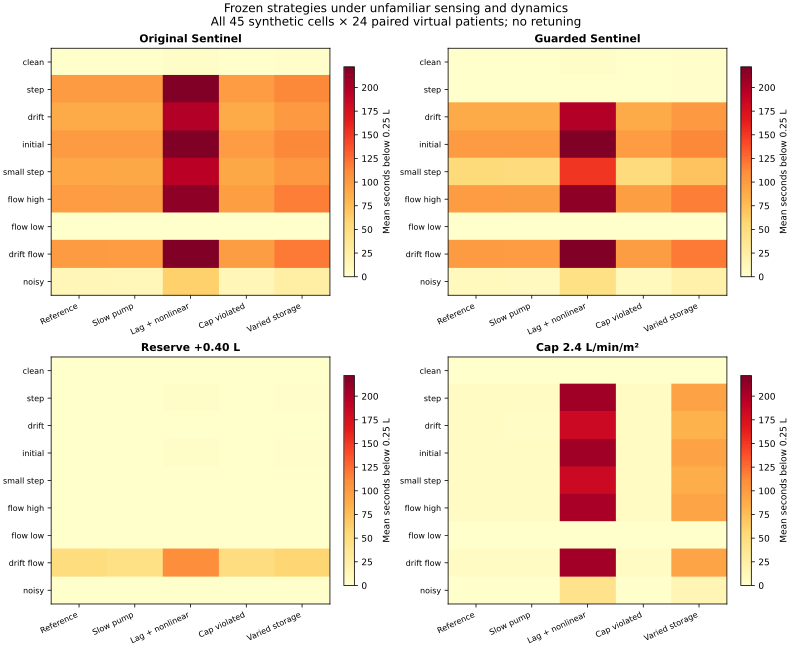
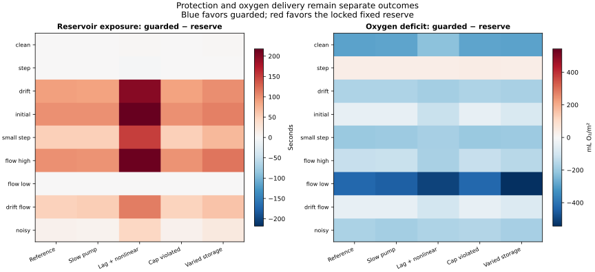
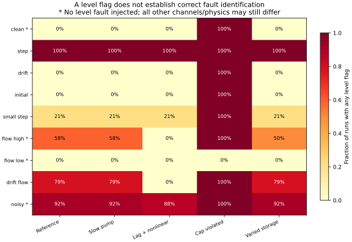

# Frozen-policy robustness study — v1.3.0

## Main finding: the earlier zero-depletion result does not generalize

The v1.2 guard and conservative settings are frozen. We test nine sensing conditions against five plant regimes, using 24 unused paired seeds (8000–8023): **45 cells and 4,320 runs**. No tuning, selection or threshold changes occur in this study. All cells remain in the results.

On the reference plant, gradual drift gives **88.83 s** mean reservoir exposure and an initial offset gives **100.25 s**; neither produces a level alarm in these runs. In the clean-sensor, altered-drainage-cap cell, every guarded run raises a level flag despite no injected sensor fault. An alarm therefore does not establish correct fault identification.

This is a synthetic falsification of general protection beyond the earlier challenge set. It is not external validation, a calibrated model of a patient, or evidence of a device malfunction.

## Frozen policies and provenance

- Original Sentinel and Guarded Sentinel remain unchanged.
- The +0.40 L reserve and 2.4 L/min/m² cap are exactly the settings selected in v1.2. They are not retuned to the new grid.
- The protocol records the SHA-256 of the source settings, and the study checks those bytes again after all runs. The source selection and all prior studies remain available.
- Six replay cells and seed 8000 are declared before simulation: clean/reference, drift/reference, initial/reference, high flow bias/reference, step/slow pump, and clean/drainage-cap violation. The remaining cells remain inspectable in the tables, maps and CSV.
- Every simulation lasts 1,200 seconds at 2-second steps. Paired policies share patient parameters, fault timing and random observation noise. Bootstrap resampling uses the 24 paired patient seeds; pooled cells are averaged within patient before resampling.

## Sensor challenges

All cases include scripted 1.8 g/dL dilution and a drainage restriction to 45%. “Clean” means no injected sensor fault, not absence of a physiological disturbance. The restriction starts uniformly between 25% and 50% of the run and lasts 15%–25% of its duration; the same timing is used for paired policies. Biases persist after onset and are not removed.

| Sensing condition | Declared engineering perturbation |
|---|---|
| clean | Original sensor noise; no added bias |
| step | +0.40 L level step at event onset |
| drift | Level rises gradually to +0.40 L over 300 s |
| initial | +0.40 L level offset present from the first observation |
| small_step | +0.10 L level step |
| flow_high | +0.75 L/min flow measurement bias; no level bias |
| flow_low | −0.75 L/min flow measurement bias; no level bias |
| drift_flow | Gradual +0.40 L level drift plus +0.75 L/min flow bias |
| noisy | Tenfold level/flow noise SD: 0.03 L and 0.15 L/min; no added bias |

## Plant regimes

| Regime | Change unknown to the controller |
|---|---|
| reference | Existing v1.2 plant and patient sampler |
| slow_pump | Pump time constant 8 s rather than 2 s |
| lagged_nonlinear | Drainage response time constant 12 s; resistance scales as 1 + 0.04 × filling pressure |
| cap_violation | Maximum drainage 9 L/min rather than the detector’s assumed 7.5 L/min |
| varied_storage | Venous compliance sampled in [0.09, 0.15] L/mmHg and resistance in [0.7, 1.1] mmHg·min/L |

The alternative plant preserves volume accounting and uses the same explicit units, while changing the pump response or drainage law. Neutral alternative settings reproduce the original numerical plant exactly. These variants are deliberately chosen engineering stress assumptions; they are not independent experimental models or evidence of higher physiological fidelity.

## Pooled outcomes: protection still has an oxygen cost

Equal weight is given to each of the 45 artificial cells. These weights do not represent clinical frequencies. Deficit AUC is mL O₂/m²; reservoir exposure is seconds.

| Strategy | Low reservoir (s) | Empty requests (s) | Deficit AUC |
|---|---:|---:|---:|
| Original Sentinel | 84.32 | 20.01 | 90.96 |
| Guarded Sentinel | 65.30 | 13.63 | 117.10 |
| Reserve +0.40 L | 7.13 | 0.00 | 285.65 |
| Flow cap 2.4 L/min/m² | 42.05 | 8.49 | 444.67 |

The fixed reserve has lower mean reservoir exposure (**7.13 s** versus **65.30 s**) but greater oxygen deficit (**285.65** versus **117.10**). This evaluation is not risk-matched, and neither outcome should be presented alone as a win.

Reserve − guarded, low_reservoir_s: -58.18 s; 95% paired percentile bootstrap interval [-70.31, -45.60] s. These intervals describe the synthetic sampler only.
Reserve − guarded, deficit_auc: 168.54 mL O₂/m²; 95% paired percentile bootstrap interval [151.62, 185.65] mL O₂/m². These intervals describe the synthetic sampler only.





## Sensing-condition means across all five plant regimes

| Sensing condition | Guarded low (s) | Reserve low (s) | Guarded deficit | Reserve deficit | Guarded runs with a level flag |
|---|---:|---:|---:|---:|---:|
| clean | 1.05 | 0.00 | 105.33 | 380.46 | 20.0% |
| step | 0.37 | 0.80 | 141.81 | 104.44 | 100.0% |
| drift | 112.70 | 0.00 | 56.78 | 229.54 | 20.0% |
| initial | 126.52 | 1.05 | 37.08 | 104.98 | 20.0% |
| small_step | 75.43 | 0.08 | 95.20 | 290.64 | 36.7% |
| flow_high | 125.50 | 0.08 | 42.20 | 182.59 | 53.3% |
| flow_low | 0.12 | 0.00 | 322.50 | 791.51 | 0.0% |
| drift_flow | 127.70 | 62.12 | 37.45 | 98.28 | 67.5% |
| noisy | 18.33 | 0.00 | 215.56 | 388.36 | 92.5% |

## Alarm ambiguity and blind spots



The flag records a discontinuity hypothesis and remains latched. Its frequency is not a sensitivity/specificity estimate: flow faults or unexpected physics can trigger a level flag, and a flag in a case with level bias does not establish an accurate bias estimate. In clean, flow_high, flow_low and noisy cases no level fault is injected. Flags in those rows are false attribution to the level channel under the test construction.

A startup offset has no trusted baseline anchor in the present observer. Slow drift can remain inside the increment envelope. A flow measurement bias corrupts both inferred drainage and the fault envelope. Changing real drainage beyond the declared cap breaks the model assumption. None of these can be fixed merely by treating the existing flag as a confirmed diagnosis.

## Complete cell outcomes

Each cell below has 24 paired virtual patients. Values are mean reservoir exposure in seconds; all oxygen, pressure, pump demand and alarm metrics remain in the machine-readable summary and CSV.

| Cell | Original | Guarded | Reserve | Flow cap |
|---|---:|---:|---:|---:|
| clean__reference | 0.00 | 0.00 | 0.00 | 0.00 |
| clean__slow_pump | 0.00 | 0.00 | 0.00 | 0.00 |
| clean__lagged_nonlinear | 2.75 | 2.75 | 0.00 | 0.00 |
| clean__cap_violation | 0.00 | 0.00 | 0.00 | 0.00 |
| clean__varied_storage | 2.50 | 2.50 | 0.00 | 0.00 |
| step__reference | 100.25 | 0.00 | 0.00 | 6.00 |
| step__slow_pump | 100.08 | 0.00 | 0.00 | 6.00 |
| step__lagged_nonlinear | 220.75 | 0.50 | 2.67 | 206.42 |
| step__cap_violation | 98.92 | 0.00 | 0.00 | 6.00 |
| step__varied_storage | 112.75 | 1.33 | 1.33 | 94.00 |
| drift__reference | 88.83 | 88.83 | 0.00 | 5.25 |
| drift__slow_pump | 88.42 | 88.42 | 0.00 | 5.08 |
| drift__lagged_nonlinear | 198.00 | 198.00 | 0.00 | 183.67 |
| drift__cap_violation | 87.58 | 87.58 | 0.00 | 5.25 |
| drift__varied_storage | 100.67 | 100.67 | 0.00 | 83.17 |
| initial__reference | 100.25 | 100.25 | 0.00 | 6.00 |
| initial__slow_pump | 100.00 | 100.00 | 0.00 | 6.00 |
| initial__lagged_nonlinear | 220.75 | 220.75 | 2.75 | 206.42 |
| initial__cap_violation | 98.92 | 98.92 | 0.00 | 6.00 |
| initial__varied_storage | 112.67 | 112.67 | 2.50 | 93.92 |
| small_step__reference | 91.17 | 52.25 | 0.00 | 5.58 |
| small_step__slow_pump | 90.83 | 51.25 | 0.00 | 5.42 |
| small_step__lagged_nonlinear | 194.33 | 151.00 | 0.00 | 183.33 |
| small_step__cap_violation | 90.50 | 51.92 | 0.00 | 5.58 |
| small_step__varied_storage | 102.83 | 70.75 | 0.42 | 86.25 |
| flow_high__reference | 99.08 | 99.08 | 0.00 | 6.00 |
| flow_high__slow_pump | 98.58 | 98.58 | 0.00 | 6.00 |
| flow_high__lagged_nonlinear | 214.42 | 214.42 | 0.00 | 203.42 |
| flow_high__cap_violation | 97.92 | 97.92 | 0.00 | 6.00 |
| flow_high__varied_storage | 117.58 | 117.50 | 0.42 | 92.67 |
| flow_low__reference | 0.00 | 0.00 | 0.00 | 0.00 |
| flow_low__slow_pump | 0.00 | 0.00 | 0.00 | 0.00 |
| flow_low__lagged_nonlinear | 0.00 | 0.00 | 0.00 | 0.00 |
| flow_low__cap_violation | 0.00 | 0.00 | 0.00 | 0.00 |
| flow_low__varied_storage | 0.58 | 0.58 | 0.00 | 0.00 |
| drift_flow__reference | 99.92 | 99.92 | 50.00 | 6.00 |
| drift_flow__slow_pump | 99.58 | 99.58 | 45.50 | 6.00 |
| drift_flow__lagged_nonlinear | 221.83 | 221.83 | 109.50 | 205.83 |
| drift_flow__cap_violation | 98.42 | 98.42 | 49.08 | 6.00 |
| drift_flow__varied_storage | 118.75 | 118.75 | 56.50 | 93.25 |
| noisy__reference | 13.67 | 8.67 | 0.00 | 0.00 |
| noisy__slow_pump | 11.50 | 7.83 | 0.00 | 0.00 |
| noisy__lagged_nonlinear | 61.00 | 45.25 | 0.00 | 41.42 |
| noisy__cap_violation | 13.67 | 8.67 | 0.00 | 0.00 |
| noisy__varied_storage | 24.33 | 21.25 | 0.00 | 14.42 |

## Next design requirement

The next candidate must address measurement credibility: for example, a separate noisy reference channel or explicitly bounded uncertainty that can declare the level unidentifiable. Any extra information must be given fairly to comparators and tested with reference error, delay and dropout. Adding a reference is not itself a novelty claim. Reusing this stress grid to design a new observer would turn it into development data; a later evaluation must use new held-out conditions and seeds. Stronger conditional baselines, physiology calibration, physical bench measurements and user demand remain unresolved. No publication readiness or commercial readiness is established here.

## Reproduce and inspect

```bash
python -m pip install -e ".[plots]"
python -m unittest discover -s tests -v
python examples/robustness_study.py
python examples/plot_robustness_study.py
python examples/report_robustness_study.py
python examples/validate_robustness_study.py
node tests/web_contract.cjs
```

[Recorded protocol](../results/robustness/protocol.json) · [Per-seed parameters](../results/robustness/parameters.json) · [All 4,320 outcomes](../results/robustness/metrics.csv) · [All means and 1,104 intervals](../results/robustness/summary.json) · [Environment](../results/robustness/environment.json)

The stress replay plots interval-end true reservoir volume and preceding interval-start measured level (plus the guarded lower estimate where defined). These timestamps differ by two seconds, as with the existing monitor convention.
